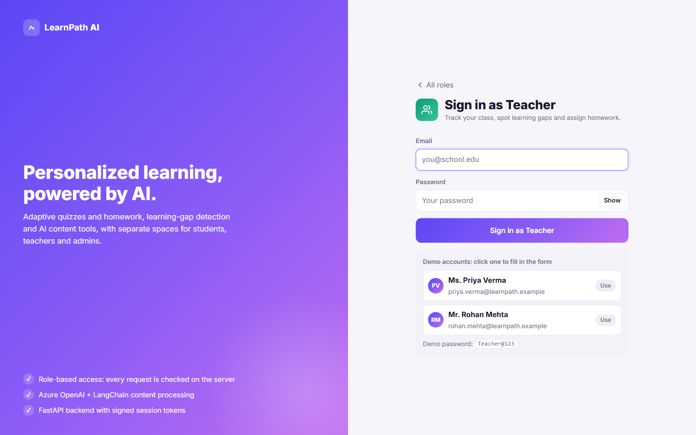
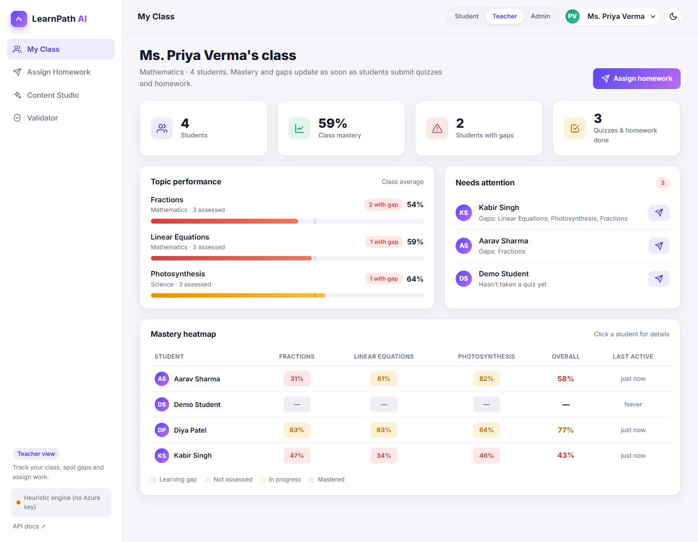
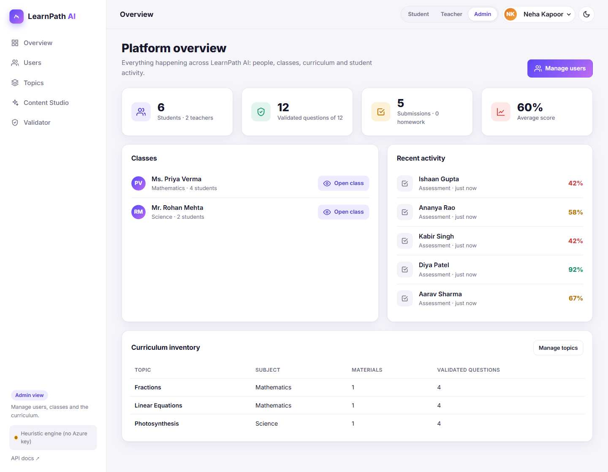

# LearnPath AI: AI-Powered Personalized Learning Platform

[](https://github.com/sakshianand19/ai-personalized-learning-platform/actions/workflows/tests.yml)


**[Live demo](https://ai-personalized-learning-platform-nu.vercel.app)** · **[API docs](https://ai-personalized-learning-platform-nu.vercel.app/docs)**

A full-stack personalized learning platform: a FastAPI backend that uses Azure OpenAI through
LangChain to process learning material and validate questions, plus an interactive web app with
separate **student**, **teacher** and **admin** views behind sign-in and role-based access control. Students take quizzes, complete adaptive
homework and follow a personalized study path; teachers track their class and assign work;
admins manage users, classes and the curriculum.


## How it works

```
 Take a quiz ──► Answers graded ──► Topic mastery updated ──► Learning gaps found
                                                                    │
         ┌──────────────────────────────────────────────────────────┘
         ▼
 Adaptive homework on the weakest topic  +  Learning path with level-matched material
```

Teachers (or the Content Studio) add learning material. The AI summarizes it, extracts key
concepts, rates its difficulty and generates questions. Every question passes a validator before
it reaches students.

## Sign-in and role-based access (RBAC)

Every visitor starts at a sign-in screen. Choose **Student**, **Teacher** or **Admin** and enter
that role's email and password; switching role from the top bar asks for the other role's
credentials too. The demo is seeded with an admin, two teachers and a class of six students with
quiz history, so every view has data from the start.



**Demo accounts** (also shown on the sign-in screen):

| Role | Email | Password |
| --- | --- | --- |
| Admin | `admin@learnpath.example` | `Admin@123` |
| Teacher | `priya.verma@learnpath.example` or `rohan.mehta@learnpath.example` | `Teacher@123` |
| Student | `demo@student.example` (no history yet) or `aarav@student.example` | `Student@123` |

| Role | What they can do |
| --- | --- |
| **Student** | Dashboard with mastery and gaps, practice quizzes, adaptive homework, personalized learning path; **only their own data** |
| **Teacher** | Class overview with a mastery heatmap and "needs attention" list, per-student insights, assign homework to one or many students, Content Studio, Validator; **only students in their own class** |
| **Admin** | Platform stats, any teacher's class, add and remove students, teachers and admins (each with an initial password), move students between classes, manage topics, Content Studio, Validator |

| Teacher: class overview | Admin: platform overview |
| --- | --- |
|  |  |

### How access is enforced

Permissions are checked **on the server for every API request**, not just hidden in the UI, so
calling the API directly can't get around them.

- **Passwords** are hashed with PBKDF2-SHA256 (120,000 iterations, random salt per password) and
  never returned by the API.
- **Sessions** are stateless bearer tokens: a JSON payload (user id, role, expiry) signed with
  HMAC-SHA256 using `SECRET_KEY`. Tampered, expired or wrongly signed tokens are rejected, and
  sessions last 8 hours by default.
- **Route guards** (`app/auth.py`): `require_roles(...)` limits endpoints to roles, and
  `ensure_student_access` limits per-student data to admins, the student's own teacher and the
  student themself. Teachers asking for another class get `403`, even if they change the URL or
  the `teacher_id` parameter.
- **Answer keys stay private:** the question bank (`/questions`) is staff-only. Students build
  quizzes from topic question counts and only see questions without answers.
- Logging in uses the same error for a wrong email and a wrong password, so accounts can't be probed.

| Capability | Student | Teacher | Admin |
| --- | :---: | :---: | :---: |
| Own dashboard, quizzes, homework, learning path | ✅ | – | – |
| View a student's gaps and activity | Self only | Own class | All |
| Assign homework | Self only | Own class | All |
| Class report and heatmap | – | Own class | Any class |
| Content Studio, question bank, validator | – | ✅ | ✅ |
| Create topics | – | ✅ | ✅ |
| Manage users and classes, platform report | – | – | ✅ |

## Screenshots

| Quiz player | Learning path |
| --- | --- |
|  |  |

**Content Studio (dark mode):** AI analysis of uploaded material and generated, validated questions.


## Features

| Area | What it does |
| --- | --- |
| **Content processing** | A LangChain `prompt \| AzureChatOpenAI \| PydanticOutputParser` chain produces a summary, key concepts and a difficulty rating for uploaded material. |
| **Question generation** | A LangChain chain generates multiple-choice questions grounded in the material. |
| **Question validation** | Deterministic rules (unique options, answer key present, etc.) plus an LLM reviewer that checks correctness, ambiguity, relevance and clarity. Only questions that pass are stored. |
| **Assessments** | Built from question IDs or topics. Answer keys are hidden from students, and submissions are graded and feed into mastery. |
| **Adaptive homework** | Targets the student's weakest topic, picks questions at the right difficulty and skips ones already answered correctly. |
| **Learning-gap identification** | Difficulty-weighted, smoothed per-topic mastery classifies each topic as a gap, not assessed, in progress or mastered, with a severity and a recommended action. |
| **Learning path** | Orders topics by urgency and recommends level-matched material for each. |

Without Azure OpenAI credentials, every AI feature falls back to deterministic heuristics, so the
app (and the live demo) works out of the box. If a model call fails or returns malformed output,
the service logs it and falls back the same way.

### Web app

The frontend is plain HTML/CSS/JS in `app/static/`, served by FastAPI at `/`, so there's no build
step.

- **Student:** dashboard, practice quizzes (keyboard shortcuts A–D and ← →) with answer review, homework, learning-path timeline
- **Teacher:** class overview and heatmap, student insights, bulk homework assignment
- **Admin:** platform overview, user and class management, topic management
- **Shared:** Content Studio (AI analysis and validated question generation) and Validator
- Light and dark themes, mobile bottom navigation

## Tech stack

| Layer | Tools |
| --- | --- |
| Backend | Python 3.12, FastAPI, Pydantic v2, SQLAlchemy 2.0 |
| AI | Azure OpenAI, LangChain (`langchain-core`, `langchain-openai`) |
| Database | SQLite by default, PostgreSQL via `DATABASE_URL` |
| Frontend | HTML, CSS, vanilla JavaScript |
| Testing and CI | Pytest, FastAPI TestClient, LangChain fake chat models, GitHub Actions |
| Hosting | Vercel |

## Architecture

```
app/
├── main.py              FastAPI app, routers, static frontend, /health
├── auth.py              RBAC: current user, role guards, per-student access rules
├── security.py          Password hashing (PBKDF2) and signed session tokens
├── static/              Single-page web app (index.html, styles.css, app.js)
├── config.py            Settings from environment / .env (pydantic-settings)
├── database.py          SQLAlchemy engine/session, table creation, demo seeding
├── models.py            ORM models (staff, students, topics, content, questions, assessments,
│                        homework, submissions, responses, topic mastery)
├── schemas.py           Pydantic request/response models
├── seed.py              Demo curriculum, staff and a class with quiz history
├── routers/             auth · students · staff · topics · content · questions · assessments ·
│                        homework · reports (class and platform)
└── services/
    ├── llm.py                 Azure OpenAI chat model (LangChain) as a FastAPI dependency
    ├── content_processor.py   LangChain chains for analysis + question generation
    ├── question_validator.py  Rule checks + LLM review chain
    ├── grading.py             Grading and incremental mastery updates
    ├── gap_analyzer.py        Learning-gap identification
    └── personalization.py     Learning paths and adaptive homework selection
tests/                   Unit + integration tests (LLM replaced by LangChain fake models)
docs/screenshots/        Images used in this README
```

**Database efficiency:** a composite index on `(topic_id, is_validated)`, `selectinload` for
assessment and homework questions, and single batched queries for mastery updates and
learning-path content (no N+1 queries). The class report builds a whole class's mastery and gaps
in three queries, however many students it has.

## API overview

All endpoints are under `/api/v1` and, apart from login, need an `Authorization: Bearer <token>`
header. Interactive docs are at `/docs`; use **Authorize** there with a token from `/auth/login`.

| Method | Path | Purpose |
| --- | --- | --- |
| `POST` | `/auth/login` | Sign in with email, password and role; returns a bearer token |
| `GET` | `/auth/me` | The signed-in user |
| `POST` / `GET` | `/students` | Create / list students (teachers only ever get their own class) |
| `PATCH` / `DELETE` | `/students/{id}` | Update a student or move them to another class / delete them and their history |
| `POST` / `GET` | `/staff` | Create / list admins and teachers (filter by `role`) |
| `DELETE` | `/staff/{id}` | Remove a staff member (their students become unassigned; the last admin can't be removed) |
| `GET` | `/reports/class` | Teacher view: per-student mastery heatmap, gaps and topic averages |
| `GET` | `/reports/platform` | Admin view: counts, average score, curriculum inventory, recent activity |
| `GET` | `/students/{id}/learning-gaps` | Gap report with severity and recommended actions |
| `GET` | `/students/{id}/learning-path` | Personalized, ordered study plan |
| `GET` | `/students/{id}/submissions` | Recent graded quizzes and homework |
| `POST` / `GET` | `/topics` | Manage curriculum topics |
| `POST` / `GET` | `/content` | Upload material (AI summary, key concepts, difficulty) / list it |
| `GET` | `/content/{id}` | Get one piece of material |
| `POST` | `/content/{id}/questions` | Generate and validate questions from material |
| `POST` | `/questions/validate` | Validate a question without saving it |
| `POST` / `GET` | `/questions` | Create (validated) / list questions |
| `POST` / `GET` | `/assessments` | Build an assessment from questions or topics / list them |
| `GET` | `/assessments/{id}` | Get an assessment (no answer keys) |
| `POST` | `/assessments/{id}/submit` | Grade answers and update mastery |
| `POST` | `/homework/generate` | Adaptive homework for the weakest (or a given) topic |
| `GET` | `/homework?student_id=…` | List a student's homework |
| `GET` | `/homework/{id}` | Get one homework assignment |
| `POST` | `/homework/{id}/submit` | Grade homework |

### Example flow

```bash
# 1. Sign in as the demo student (id 1) and keep the token
TOKEN=$(curl -s -X POST localhost:8000/api/v1/auth/login -H "Content-Type: application/json" \
  -d '{"email": "demo@student.example", "password": "Student@123", "role": "student"}' | jq -r .access_token)

# 2. Build a quiz across the seeded topics (the response has its id and questions, without answers)
curl -X POST localhost:8000/api/v1/assessments -H "Authorization: Bearer $TOKEN" \
  -H "Content-Type: application/json" -d '{"title": "Diagnostic", "topic_ids": [1, 2, 3]}'

# 3. Submit answers, using the assessment id from step 2
curl -X POST localhost:8000/api/v1/assessments/2/submit -H "Authorization: Bearer $TOKEN" \
  -H "Content-Type: application/json" \
  -d '{"student_id": 1, "answers": [{"question_id": 1, "answer": "Chlorophyll"}]}'

# 4. See your learning gaps, then get adaptive homework
curl localhost:8000/api/v1/students/1/learning-gaps -H "Authorization: Bearer $TOKEN"
curl -X POST localhost:8000/api/v1/homework/generate -H "Authorization: Bearer $TOKEN" \
  -H "Content-Type: application/json" -d '{"student_id": 1}'
```

## Running locally

```bash
git clone https://github.com/sakshianand19/ai-personalized-learning-platform.git
cd ai-personalized-learning-platform
python -m venv .venv
.venv\Scripts\activate             # macOS/Linux: source .venv/bin/activate
pip install -r requirements-dev.txt
copy .env.example .env             # macOS/Linux: cp .env.example .env (optional: add Azure keys)
uvicorn app.main:app --reload
```

Open http://localhost:8000 for the web app or http://localhost:8000/docs for the API.

## Configuration

| Variable | Default | Description |
| --- | --- | --- |
| `AZURE_OPENAI_ENDPOINT` | – | e.g. `https://my-resource.openai.azure.com/` |
| `AZURE_OPENAI_API_KEY` | – | Azure OpenAI key |
| `AZURE_OPENAI_DEPLOYMENT` | – | Chat model deployment name |
| `AZURE_OPENAI_API_VERSION` | `2024-10-21` | API version |
| `DATABASE_URL` | SQLite (`/tmp` on Vercel) | Any SQLAlchemy URL; `postgres://` URLs are supported |
| `SECRET_KEY` | development key | Signs session tokens. **Set a long random value in production**; all instances must share it |
| `SESSION_HOURS` | `8` | How long a sign-in lasts |
| `SEED_DEMO_DATA` | `true` | Seed demo topics, content, questions, staff and a class with quiz history |
| `MASTERY_THRESHOLD` | `0.6` | Mastery below this is a learning gap |
| `MIN_ATTEMPTS_FOR_GAP` | `2` | Answers needed before a topic can be judged |

## Testing

```bash
pytest
```

Unit and integration tests cover the validation rules, content heuristics, LangChain chains
(using `FakeListChatModel` with canned JSON, including malformed-output fallbacks), mastery maths,
gap classification and full API flows against an in-memory database. GitHub Actions runs them on
every push.

## Deployment

The app is deployed on Vercel, which detects FastAPI automatically from `app/main.py`; no extra
configuration is needed.

1. Import the GitHub repo at [vercel.com/new](https://vercel.com/new) (no build settings needed).
2. Under **Settings → Environment Variables**, set `SECRET_KEY` to a long random string (for
   example the output of `python -c "import secrets; print(secrets.token_urlsafe(48))"`), and
   optionally the Azure OpenAI variables. Without `SECRET_KEY` the app falls back to a public
   development key, which means anyone who reads this repo could forge a session token.
3. For persistent data, set `DATABASE_URL` to a hosted PostgreSQL database.

**About the live demo:** it runs without Azure OpenAI keys, so its AI features use the built-in
heuristics. It also uses SQLite in Vercel's temporary storage, which is separate for each server
instance and resets when an instance restarts, so students and results you add may not persist.
The demo data re-seeds automatically.

## Author

**Sakshi Anand** · [GitHub](https://github.com/sakshianand19) · [LinkedIn](https://www.linkedin.com/in/sakshi-anand-731464216/)
