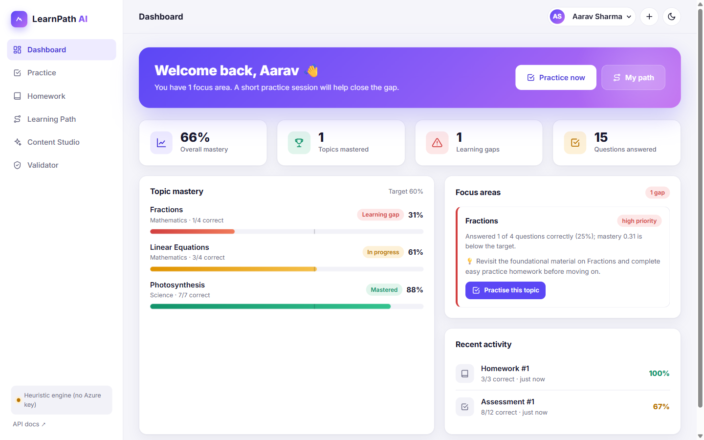
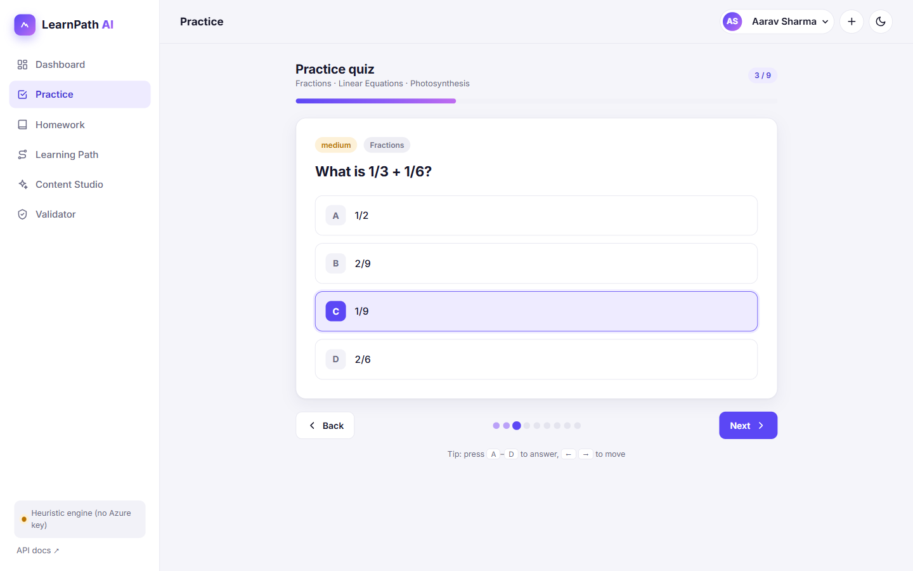
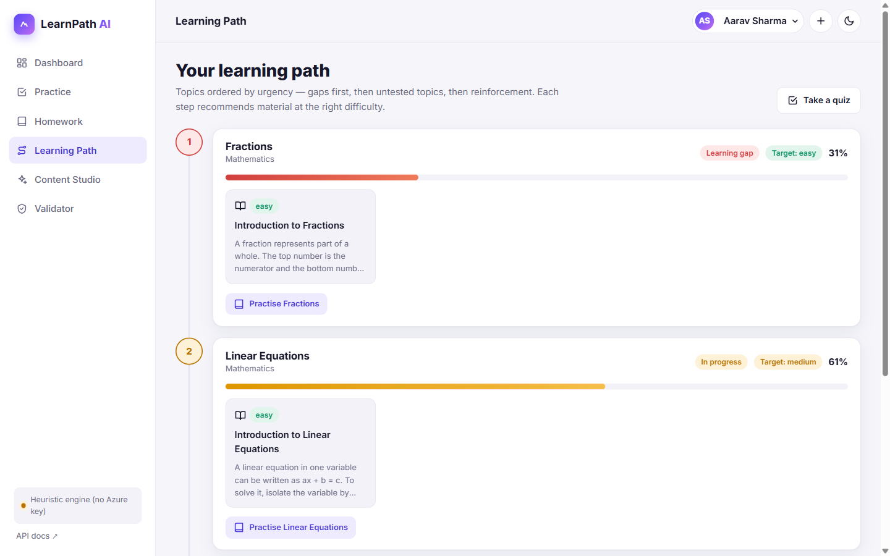
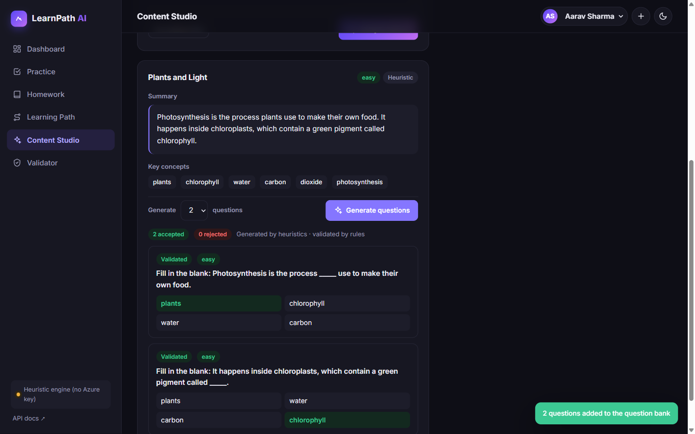

# LearnPath AI: AI-Powered Personalized Learning Platform

[](https://github.com/sakshianand19/ai-personalized-learning-platform/actions/workflows/tests.yml)


**[Live demo](https://ai-personalized-learning-platform-nu.vercel.app)** · **[API docs](https://ai-personalized-learning-platform-nu.vercel.app/docs)**

A full-stack personalized learning platform: a FastAPI backend that uses Azure OpenAI through
LangChain to process learning material and validate questions, plus an interactive web app where
students take quizzes, complete adaptive homework, see their learning gaps and follow a
personalized study path.



## How it works

```
 Take a quiz ──► Answers graded ──► Topic mastery updated ──► Learning gaps found
                                                                    │
         ┌──────────────────────────────────────────────────────────┘
         ▼
 Adaptive homework on the weakest topic  +  Learning path with level-matched material
```

Teachers (or the Content Studio) add learning material. The AI summarizes it, extracts key
concepts, rates its difficulty and generates questions. Every question passes a validator before
it reaches students.

## Screenshots

| Quiz player | Learning path |
| --- | --- |
|  |  |

**Content Studio (dark mode):** AI analysis of uploaded material and generated, validated questions.



## Features

| Area | What it does |
| --- | --- |
| **Content processing** | A LangChain `prompt \| AzureChatOpenAI \| PydanticOutputParser` chain produces a summary, key concepts and a difficulty rating for uploaded material. |
| **Question generation** | A LangChain chain generates multiple-choice questions grounded in the material. |
| **Question validation** | Deterministic rules (unique options, answer key present, etc.) plus an LLM reviewer that checks correctness, ambiguity, relevance and clarity. Only questions that pass are stored. |
| **Assessments** | Built from question IDs or topics. Answer keys are hidden from students, and submissions are graded and feed into mastery. |
| **Adaptive homework** | Targets the student's weakest topic, picks questions at the right difficulty and skips ones already answered correctly. |
| **Learning-gap identification** | Difficulty-weighted, smoothed per-topic mastery classifies each topic as a gap, not assessed, in progress or mastered, with a severity and a recommended action. |
| **Learning path** | Orders topics by urgency and recommends level-matched material for each. |

Without Azure OpenAI credentials, every AI feature falls back to deterministic heuristics, so the
app (and the live demo) works out of the box. If a model call fails or returns malformed output,
the service logs it and falls back the same way.

### Web app

The frontend is plain HTML/CSS/JS in `app/static/`, served by FastAPI at `/`, so there's no build
step.

- **Dashboard:** overall mastery, per-topic mastery bars, prioritized learning gaps with one-click practice, recent activity
- **Practice:** pick topics and take a quiz (keyboard shortcuts A–D and ← →), then review every answer with explanations
- **Homework:** assign adaptive homework (auto-targets the weakest topic) and complete it in the quiz player
- **Learning path:** a timeline ordered by urgency with level-matched study material
- **Content Studio:** paste material for AI analysis and generate validated questions
- **Validator:** check a question against the rules and the LLM reviewer
- Light and dark themes, multiple students, mobile bottom navigation

## Tech stack

| Layer | Tools |
| --- | --- |
| Backend | Python 3.12, FastAPI, Pydantic v2, SQLAlchemy 2.0 |
| AI | Azure OpenAI, LangChain (`langchain-core`, `langchain-openai`) |
| Database | SQLite by default, PostgreSQL via `DATABASE_URL` |
| Frontend | HTML, CSS, vanilla JavaScript |
| Testing and CI | Pytest, FastAPI TestClient, LangChain fake chat models, GitHub Actions |
| Hosting | Vercel |

## Architecture

```
app/
├── main.py              FastAPI app, routers, static frontend, /health
├── static/              Single-page web app (index.html, styles.css, app.js)
├── config.py            Settings from environment / .env (pydantic-settings)
├── database.py          SQLAlchemy engine/session, table creation, demo seeding
├── models.py            ORM models (students, topics, content, questions, assessments,
│                        homework, submissions, responses, topic mastery)
├── schemas.py           Pydantic request/response models
├── routers/             students · topics · content · questions · assessments · homework
└── services/
    ├── llm.py                 Azure OpenAI chat model (LangChain) as a FastAPI dependency
    ├── content_processor.py   LangChain chains for analysis + question generation
    ├── question_validator.py  Rule checks + LLM review chain
    ├── grading.py             Grading and incremental mastery updates
    ├── gap_analyzer.py        Learning-gap identification
    └── personalization.py     Learning paths and adaptive homework selection
tests/                   Unit + integration tests (LLM replaced by LangChain fake models)
docs/screenshots/        Images used in this README
```

**Database efficiency:** a composite index on `(topic_id, is_validated)`, `selectinload` for
assessment and homework questions, and single batched queries for mastery updates and
learning-path content (no N+1 queries).

## API overview

All endpoints are under `/api/v1`. Interactive docs are at `/docs`.

| Method | Path | Purpose |
| --- | --- | --- |
| `POST` / `GET` | `/students` | Create / list students |
| `GET` | `/students/{id}/learning-gaps` | Gap report with severity and recommended actions |
| `GET` | `/students/{id}/learning-path` | Personalized, ordered study plan |
| `GET` | `/students/{id}/submissions` | Recent graded quizzes and homework |
| `POST` / `GET` | `/topics` | Manage curriculum topics |
| `POST` / `GET` | `/content` | Upload material (AI summary, key concepts, difficulty) / list it |
| `GET` | `/content/{id}` | Get one piece of material |
| `POST` | `/content/{id}/questions` | Generate and validate questions from material |
| `POST` | `/questions/validate` | Validate a question without saving it |
| `POST` / `GET` | `/questions` | Create (validated) / list questions |
| `POST` / `GET` | `/assessments` | Build an assessment from questions or topics / list them |
| `GET` | `/assessments/{id}` | Get an assessment (no answer keys) |
| `POST` | `/assessments/{id}/submit` | Grade answers and update mastery |
| `POST` | `/homework/generate` | Adaptive homework for the weakest (or a given) topic |
| `GET` | `/homework?student_id=…` | List a student's homework |
| `GET` | `/homework/{id}` | Get one homework assignment |
| `POST` | `/homework/{id}/submit` | Grade homework |

### Example flow

```bash
# 1. Diagnostic assessment across the seeded topics
curl -X POST localhost:8000/api/v1/assessments -H "Content-Type: application/json" \
  -d '{"title": "Diagnostic", "topic_ids": [1, 2, 3]}'

# 2. Submit answers for the demo student
curl -X POST localhost:8000/api/v1/assessments/1/submit -H "Content-Type: application/json" \
  -d '{"student_id": 1, "answers": [{"question_id": 1, "answer": "Chlorophyll"}]}'

# 3. See the learning gaps, then assign adaptive homework
curl localhost:8000/api/v1/students/1/learning-gaps
curl -X POST localhost:8000/api/v1/homework/generate -H "Content-Type: application/json" \
  -d '{"student_id": 1}'
```

## Running locally

```bash
git clone https://github.com/sakshianand19/ai-personalized-learning-platform.git
cd ai-personalized-learning-platform
python -m venv .venv
.venv\Scripts\activate             # macOS/Linux: source .venv/bin/activate
pip install -r requirements-dev.txt
copy .env.example .env             # macOS/Linux: cp .env.example .env (optional: add Azure keys)
uvicorn app.main:app --reload
```

Open http://localhost:8000 for the web app or http://localhost:8000/docs for the API.

## Configuration

| Variable | Default | Description |
| --- | --- | --- |
| `AZURE_OPENAI_ENDPOINT` | – | e.g. `https://my-resource.openai.azure.com/` |
| `AZURE_OPENAI_API_KEY` | – | Azure OpenAI key |
| `AZURE_OPENAI_DEPLOYMENT` | – | Chat model deployment name |
| `AZURE_OPENAI_API_VERSION` | `2024-10-21` | API version |
| `DATABASE_URL` | SQLite (`/tmp` on Vercel) | Any SQLAlchemy URL; `postgres://` URLs are supported |
| `SEED_DEMO_DATA` | `true` | Seed demo topics, content, questions and a student |
| `MASTERY_THRESHOLD` | `0.6` | Mastery below this is a learning gap |
| `MIN_ATTEMPTS_FOR_GAP` | `2` | Answers needed before a topic can be judged |

## Testing

```bash
pytest
```

Unit and integration tests cover the validation rules, content heuristics, LangChain chains
(using `FakeListChatModel` with canned JSON, including malformed-output fallbacks), mastery maths,
gap classification and full API flows against an in-memory database. GitHub Actions runs them on
every push.

## Deployment

The app is deployed on Vercel, which detects FastAPI automatically from `app/main.py`; no extra
configuration is needed.

1. Import the GitHub repo at [vercel.com/new](https://vercel.com/new) (no build settings needed).
2. Optionally add the Azure OpenAI variables under **Settings → Environment Variables**.
3. For persistent data, set `DATABASE_URL` to a hosted PostgreSQL database.

**About the live demo:** it runs without Azure OpenAI keys, so its AI features use the built-in
heuristics. It also uses SQLite in Vercel's temporary storage, which is separate for each server
instance and resets when an instance restarts, so students and results you add may not persist.
The demo data re-seeds automatically.

## Author

**Sakshi Anand** · [GitHub](https://github.com/sakshianand19) · [LinkedIn](https://www.linkedin.com/in/sakshi-anand-731464216/)
